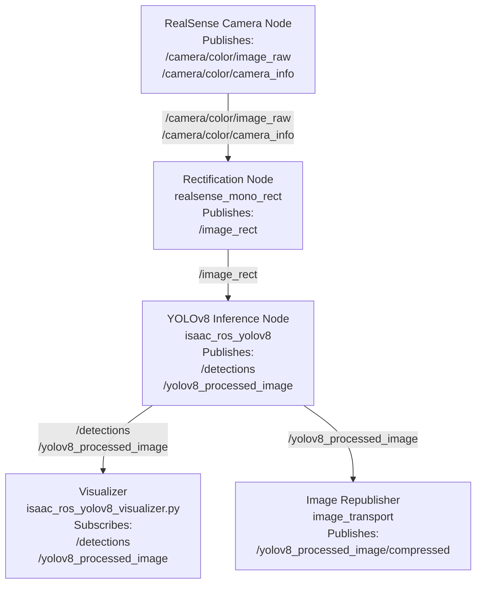

# ISAAC-ROS Object Detection Container

This repository provides a ROS 2–based object‑detection container using Isaac ROS YOLOv8 [NVIDIA-ROS-Object-Detection](https://nvidia-isaac-ros.github.io/v/release-3.2/repositories_and_packages/isaac_ros_object_detection/isaac_ros_yolov8/index.html). 

- automatic model download + ONNX export for yolov8n/s/m/l/x

- standalone mode (camera + detection in one container)

- composite mode (camera in the realsense container, detection in this one)

- bag mode (detection on the looping Isaac ROS quickstart rosbag, no camera needed)

For constrained GPUs, use the smaller `yolov8n` model. `yolov8s` can trigger CUDA OOMs on lower-VRAM Jetson or desktop GPUs even though it is the default in some older examples.

## 🚀 Quick Start

Build and run the container with the defaults (`yolov8n`, `composite`, `sparse`):
```bash
cd .devcontainer
docker compose up --build
```
Pick a different configuration per run without editing any file:
```bash
RUN_MODE=standalone docker compose up
RUN_MODE=bag VIS_MODE=full docker compose up
YOLO_MODEL=yolov8s VIS_MODE=none docker compose up
```
Variables set in the shell apply only to that command. Without them, the defaults from `docker-compose.yml` apply. To change the defaults permanently, edit them there (`${RUN_MODE:-composite}` etc.).

`export RUN_MODE=bag` keeps the value for the whole terminal session, until `unset RUN_MODE`. Scripts can pass the variables via the environment of the `docker compose` process, e.g. `subprocess.run([...], env=...)` in Python.

Check which values Compose will use without starting anything:
```bash
RUN_MODE=bag docker compose config | grep -E "RUN_MODE|VIS_MODE|YOLO_MODEL"
```

## 🧩 How it starts

1. [entrypoint.sh](entrypoint.sh) sources ROS and runs [setup_yolo_v8_assets.sh](setup_yolo_v8_assets.sh), which makes sure the model exists (downloading and exporting it if needed).
2. It then `exec`s [object_detection.launch.py](src/object_detection/launch/object_detection.launch.py), which contains all mode logic.

The visualizer and the image republisher respawn automatically if they crash. If the Isaac ROS container (camera + YOLOv8) or the bag player dies, the launch shuts down and Docker restarts the container (`restart: always`).

The launch file can also be used directly inside the container:
```bash
ros2 launch object_detection object_detection.launch.py --show-args
ros2 launch object_detection object_detection.launch.py run_mode:=bag vis_mode:=full model:=yolov8n
```
After changing anything in `src/`, rebuild with `./build.sh`.

## ⚙️ Configuration

YOLO_MODEL

    yolov8n (default, lower memory usage)
    yolov8s, yolov8m, yolov8l, yolov8x (larger, need more VRAM)
    <custom> (must be placed manually, see below)

RUN_MODE

    standalone → RealSense camera + rectification + detection + visualization in this container
    composite  → detection only, expects /image_rect + /camera_info_rect from another container (default)
    bag        → detection on the looping quickstart rosbag (publishes /image_rect itself)

VIS_MODE

    sparse → displays only persons, dogs and potted plants (default)
    full   → displays all classes
    none   → no visualizer

The detection node always publishes all found classes on /detections_output, VIS_MODE only affects /yolov8_processed_image (and its /compressed version).

## 📁 Asset Management

The container expects model assets in:
```
${ISAAC_ROS_WS}/isaac_ros_assets/models/yolov8/
```
For yolov8n/s/m/l/x the container automatically:

- downloads the Isaac ROS quickstart assets once (rosbag for `RUN_MODE=bag`)
- downloads `<model>.pt` from ultralytics and exports it to `<model>.onnx`
- builds the TensorRT engine `<model>.plan` with `trtexec` (about 8 minutes for yolov8n on the Jetson)

The engine is built before launch on purpose: letting Isaac ROS build it while the pipeline is running runs out of memory on the Jetson.

Custom models

For any other model name, place
```
<model>.onnx
<model>.plan   (optional, built with trtexec on first start if missing)
```
into `isaac_ros_assets/models/yolov8/` and set `YOLO_MODEL=<model>`. If the file is missing, the container exits with an error.

## 🧠 Runtime Modes
Standalone Mode

Runs:

- RealSense camera pipeline
- YOLOv8 inference
- Visualization node
- Image republisher

Useful for development or running on a single machine.

Composite Mode

Runs only:

- YOLOv8 inference
- Visualization node
- Image republisher

Assumes another container publishes camera topics.

Bag Mode

Same as composite, plus `ros2 bag play --loop` of the quickstart rosbag as the image source. Useful for testing detection without the robot's camera. Note that the bag publishes /image_rect on the shared host network.

