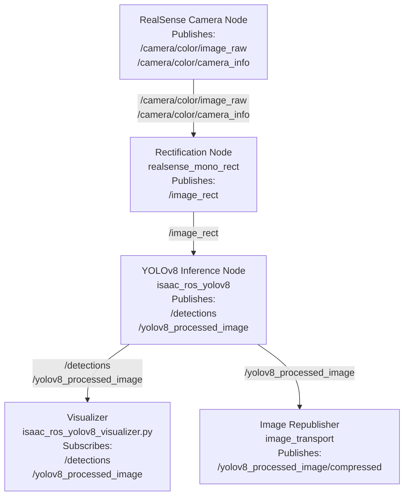

# ISAAC-ROS Object Detection Container

This repository provides a ROS 2–based object‑detection container using Isaac ROS YOLOv8 [NVIDIA-ROS-Object-Detection](https://nvidia-isaac-ros.github.io/v/release-3.2/repositories_and_packages/isaac_ros_object_detection/isaac_ros_yolov8/index.html). 

- automatic asset setup (default model only)

- selectable YOLOv8 model variants

- standalone mode (camera + detection in one container)

- multi‑container mode (camera in one container, detection in another)


The container is controlled entirely through environment variables in docker-compose.yml.

For constrained GPUs, use the smaller `yolov8n` model. `yolov8s` can trigger CUDA OOMs on lower-VRAM Jetson or desktop GPUs even though it is the default in some older examples.

## 🚀 Quick Start

Build and run the container
```bash
docker compose up --build
```
The entrypoint will:

- check if the required YOLOv8 model assets exist

- download/export them if using the default model

- launch ROS in the selected mode


## ⚙️ Configuration (docker‑compose)

You control the container behavior using two environment variables:
YOLO_MODEL

Select which YOLOv8 model to run:

    yolov8n (default, auto‑downloadable, lower memory usage)

    yolov8s (larger model; use only if your GPU has spare VRAM)

    yolov8m, yolov8l, yolov8x (must be manually provided) #TODO implement auto pulling and conversion for other models

RUN_MODE

Choose how the container launches:

    standalone → camera + detection + visualization in one container

    multi → detection only, expects another container to provide camera topics

VIS_MODE

Select the mode for visualization

    sparse displays only persons, dogs and potted plants

    full displays all 68 classes

The node still publishes all found classes, this is only for the visualization purposes

Example:
yaml

services:
  object_detection:
    environment:
      YOLO_MODEL: yolov8n
      RUN_MODE: standalone
      VIS_MODE: sparse


## 📁 Asset Management

The container expects model assets in:
```
${ISAAC_ROS_WS}/isaac_ros_assets/models/yolov8/
```
Default model (yolov8n)

If missing, the container will automatically:

- download Isaac ROS assets
- export the YOLOv8n ONNX model

Non‑default models

If you set:
```
YOLO_MODEL=yolov8m
```
…then the container will not download the model.

You must manually place:
```
yolov8m.onnx
yolov8m.plan   (optional, will be generated by Isaac ROS if missing)
```
into:
```
isaac_ros_assets/models/yolov8/
```
If the files are missing, the container will exit with a clear error message.

## 🧠 Runtime Modes
Standalone Mode

Runs:

- RealSense camera pipeline
- YOLOv8 inference
- Visualization node
- Image republisher

Useful for development or running on a single machine.
Multi‑Container Mode

Runs only:

- YOLOv8 inference
- Visualization node
-  Image republisher

Assumes another container publishes camera topics.

